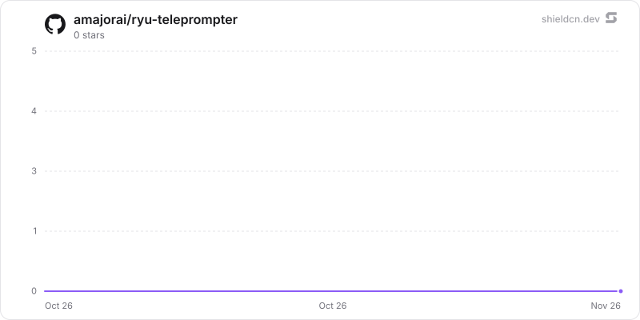

<div align="center">

# teleprompter

</div>

A voice-following teleprompter that scrolls your script as you speak, using Ryu speech-to-text.

> **The public home of `ryu-teleprompter`.** Source, builds, and releases live here —
> binaries for every platform are attached to each release.
>
> This tree is generated from the Ryu monorepo, so commits pushed here
> directly are replaced on the next sync. **Pull requests are welcome** —
> open them here and they are ported into the monorepo, then flow back out.
> Ryu as a whole: https://github.com/amajorai/ryu

## Install

**App:** [Install](ryu://apps/com.ryu.teleprompter) (opens the Ryu desktop app and asks you to confirm)

**CLI:**

```bash
ryu apps add com.ryu.teleprompter
```

## Source & build

This is the **source of record** for the app UI. It imports Ryu's private
`@ryu/ui` design system, so it does **not** build standalone outside the
monorepo — it **builds inside the amajorai/ryu monorepo workspace**.
The shipped bundle is the built artifact, produced by the monorepo build.

## License

Apache-2.0 — see [LICENSE](./LICENSE).

# Teleprompter

A Ryu Companion that scrolls a script as you read it aloud. Scrolling follows your
voice using Ryu's own speech-to-text through `media.transcribe`. The app does not
pick an engine: the Desktop and Island hosts send each clip with the user's Voice
Recognition engine (`voice-input` preference: Parakeet, Whisper, audio.cpp, or
Gateway), the same one first-party voice input uses. With nothing saved, that is the
Voice Recognition default (Parakeet). Only when the preference cannot be read does
Core use its default STT engine (`default_stt_engine`). It does not use the
browser's Web Speech API or a model that runs inside the page.

Voice following works in both Desktop and Island.

The app uses the shared `media.recording`, `media.transcribe`, and `storage:kv`
host contracts. It has no Core server code of its own and keeps no separate
credential store. The Companion frame cannot open the microphone itself. Instead, the
host records clips of about 2.5 seconds. The app then:

1. skips silent clips with an adaptive energy gate;
2. puts the last 0.8 seconds of the previous clip in front of each new clip;
3. encodes each window as 16 kHz mono WAV;
4. sends the window to Core through `media.transcribe`.

The speech matcher compares the end of each transcript with the script near the
current word. Because it compares text and not timestamps, it also works with
engines that return text only. When voice following is unavailable, auto-scroll
moves at a fixed number of words per minute.

The app stores saved scripts, the current draft, and display settings in its
private key-value storage. Host storage failures are shown to the user and never
fall back to another store; only a plain-browser preview with no host bridge keeps
data in browser storage (or memory).

Build the self-contained Companion inside the Ryu workspace:

```sh
rtk bun run --cwd apps-store/teleprompter/ui build
rtk bun run --cwd apps-store/teleprompter/ui check-types
rtk bun test apps-store/teleprompter/ui/src
```

The manifest loads `ui/dist/index.html`. Keep generated UI artifacts in this app,
not in Core fixtures.

## Star History

<a href="https://github.com/amajorai/ryu-teleprompter/stargazers">
  <picture>
    <source media="(prefers-color-scheme: dark)" srcset="./.github/shieldcn/star-chart-dark.svg" />
    
  </picture>
</a>
